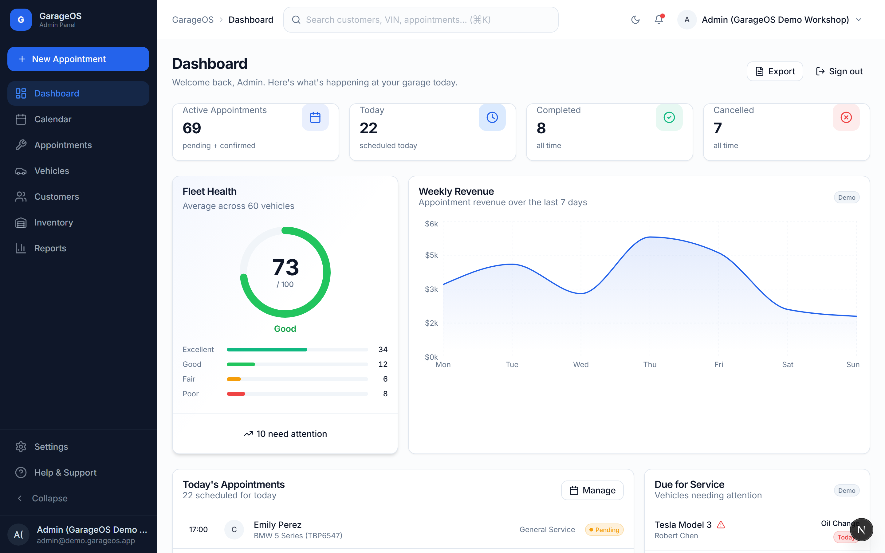
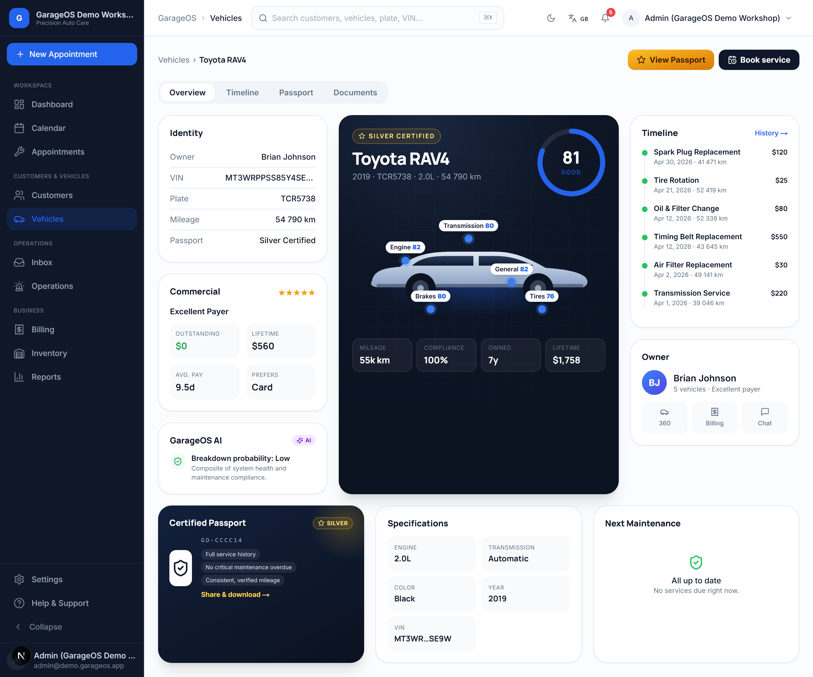
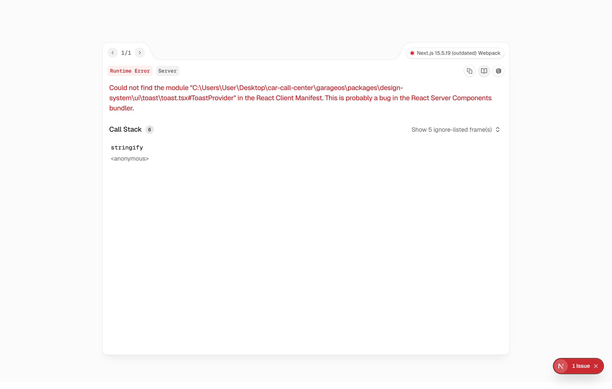
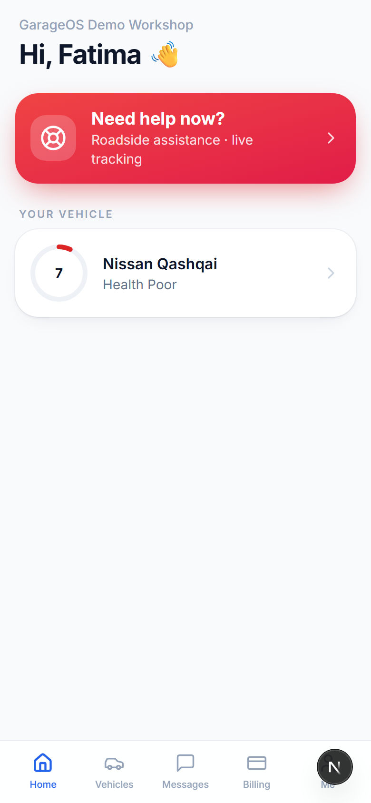
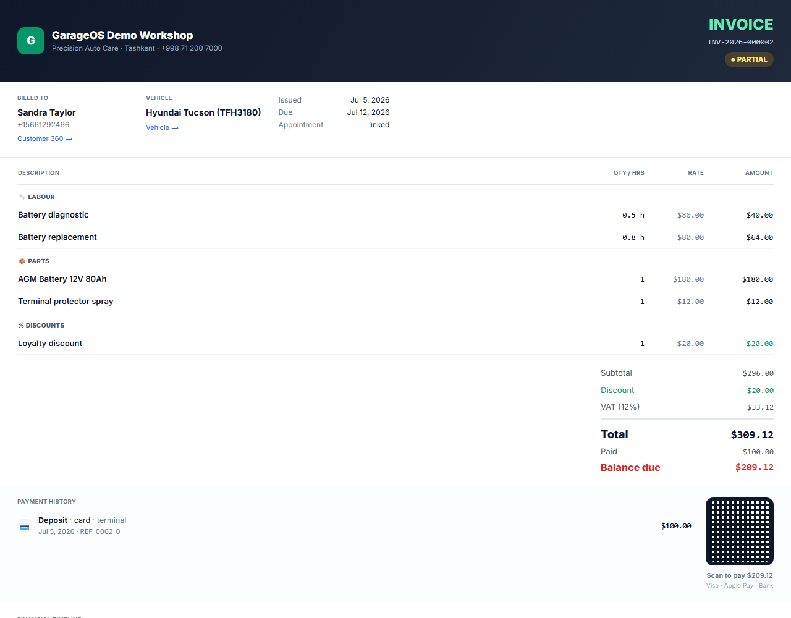
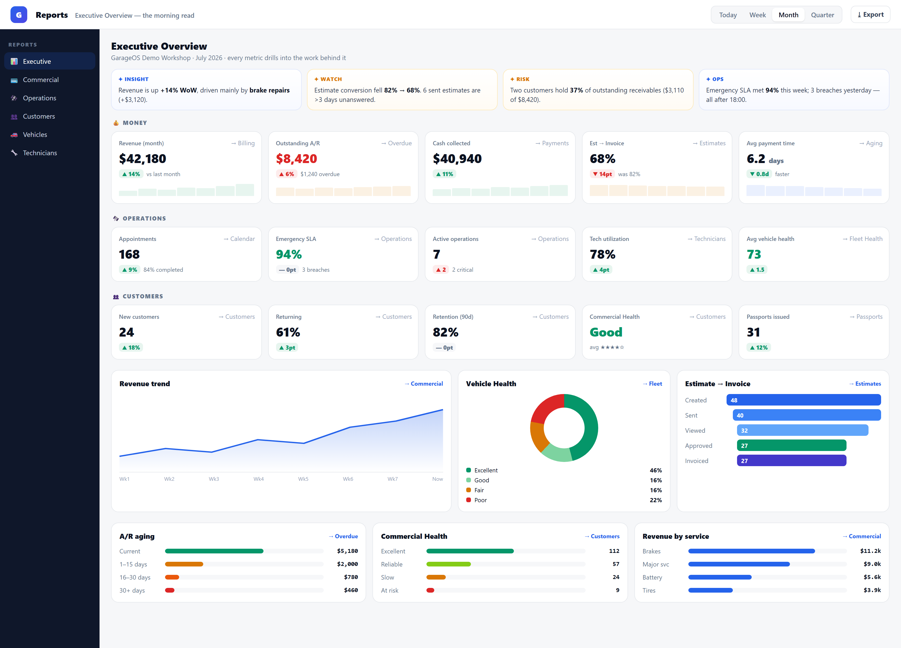
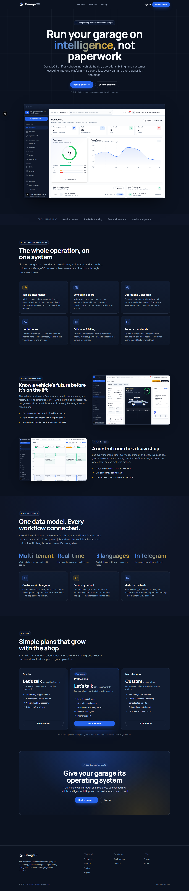

<div align="center">

# GarageOS

**The operating system for independent garages.**

Booking, service workflow, billing, reports and a Telegram Mini App for customers, all running on one shared event stream.




</div>

---

## What it is

GarageOS is a multi-tenant SaaS platform for running a car service center end to end:

> A customer books, an advisor manages, a mechanic works, an invoice is generated and paid.
> Reports, the vehicle passport and the digital twin all stay in sync.

Every action emits a domain event (`AppointmentCreated`, `EstimateApproved`, …) into a single stream. The calendar, notifications, the financial ledger, the operations center and the customer's Telegram app all read from that stream, so no part of the system keeps its own copy of the truth.

## Features

| Area | What you get |
|---|---|
| **Appointments & Calendar** | Book from the calendar, the vehicle page or Customer 360; reschedule, edit, delete |
| **Service workflow** | Operations Center, operational cases, mechanic assignment, live status |
| **Billing** | Estimates → invoices, editable line items, PDF with pay-QR, shareable public `/invoice/[id]` link, send by email or Telegram |
| **Financial ledger** | Double-entry `LedgerEntry` model with a built-in integrity reconciliation (debit − credit = outstanding) |
| **Vehicle Intelligence Center** | A "digital twin": health, certified passport, predictions and full timeline on one screen |
| **Reports & Analytics** | Executive overview, commercial report, AR aging, conversion funnel, hand-built SVG charts |
| **Unified Inbox** | One conversation model across channels, with attachments flowing into the timeline |
| **Telegram Mini App** | Customers book, approve or decline estimates, view invoices, chat, and request roadside help with live tracking |
| **Public website** | Landing, pricing, security, docs, legal pages and a read-only **Demo Mode** |
| **Localization** | English, Russian and Uzbek, with a CI check that fails on new hardcoded strings |

## Screenshots

| Vehicle Intelligence | Calendar | Telegram Mini App |
|---|---|---|
|  |  |  |

| Invoice (print / PDF) | Reports | Landing page |
|---|---|---|
|  |  |  |

More in [`garageos/docs/screenshots`](garageos/docs/screenshots) and [`garageos/docs/design`](garageos/docs/design).

## Architecture

```
  Telegram bot ──► Mini App (/mini) ─┐
                                     │  customer API  (Telegram initData HMAC, customer JWT)
  Staff dashboard (Next.js 15) ──────┤
  Marketing site + Demo Mode ────────┤  staff API     (JWT, roles, per-tenant scope)
                                     ▼
                         FastAPI  (async, service layer, Unit of Work)
                                     │
                    ┌────────────────┼─────────────────┐
                    ▼                ▼                 ▼
               PostgreSQL 16     Domain events       Redis 7
            (service_center_id   (outbox → ledger,   (rate limiting,
             on every table)      timeline, notifs)   caching)
```

- **Multi-tenancy:** every business table carries `service_center_id`, and there is a script that verifies tenants can't see each other's data (`make verify`).
- **Patterns:** repository + Unit of Work, domain events with an outbox, and an analytics projection layer that feeds one generic report renderer.
- **Security:** Redis rate limiting on auth and roadside endpoints, an append-only audit log of logins and token refreshes, optional Sentry, and customer and staff tokens that can't be used on each other's routes.
- The design decisions are written up as ADRs in [`garageos/docs/ADRs`](garageos/docs/ADRs).

## Tech stack

| Layer | Tech |
|---|---|
| Backend | Python 3.11+, FastAPI, SQLAlchemy 2 (async), asyncpg, Alembic, Pydantic 2, APScheduler, structlog |
| Frontend | Next.js 15, React 19, TypeScript, Tailwind CSS, a shared `design-system` package |
| Data | PostgreSQL 16, Redis 7 |
| Customer channel | Telegram Bot + Telegram Web App (Mini App) |
| Infra | Docker Compose, Caddy (auto-HTTPS) for production, nightly backups + restore test |
| Quality | pytest, Playwright e2e, ESLint, `tsc`, i18n coverage check, GitHub Actions CI |

## Repository layout

```
garageos/
├── backend/            FastAPI app: api/, services/, repositories/, models/, seeds/, alembic/
├── admin-dashboard/    Next.js app: staff console, /mini (Telegram), marketing site, demo
├── packages/           shared design-system
├── telegram-bot/       the bot that opens the Mini App
├── docker/             Dockerfiles, Caddyfile, nginx
├── scripts/            demo.sh, dev.sh, backup.sh, restore-test.sh
├── docs/               architecture, ADRs, deployment guide, demo flow, screenshots
├── docker-compose.yml        local stack
└── docker-compose.prod.yml   production stack
```

## Quick start

**Requirements:** Docker, Python 3.11+, Node.js 20+.

```bash
git clone https://github.com/Shoamirg/garageos.git
cd garageos/garageos
cp .env.example .env

# 1. Backend: virtualenv + dependencies
python -m venv backend/.venv
backend/.venv/bin/python -m pip install -r backend/requirements.txt
# Windows: backend/.venv/Scripts/python -m pip install -r backend/requirements.txt

# 2. One command: fresh Postgres + Redis, migrations and a fully populated demo garage
bash scripts/demo.sh            # or: make demo PYTHON=.venv/bin/python

# 3. Run the API  → http://localhost:8000/docs
cd backend && .venv/bin/python -m uvicorn app.main:app --reload

# 4. Run the dashboard  → http://localhost:3000
cd ../admin-dashboard && npm install && npm run dev
```

The seed creates a demo service center with its customers, vehicles, appointments, about 12 months of invoice history, and staff accounts (the default demo password is set in `backend/app/seeds/mechanics.py`).

### Try the local Uzbek service-work demo

Sign in to the staff dashboard with the seeded demo administrator (`admin@demo.garageos.app`, password `demo1234`). New browser sessions default to Uzbek. In **Navbatlar**, create an appointment for an existing customer and vehicle, then:

1. Confirm the appointment and assign a mechanic.
2. Start the work, then complete it by entering the performed service (for example, `Diagnostika`) and optional details. The completed work appears in the vehicle history.
3. Use **Hisob yaratish / ochish** on the completed appointment. Enter a line description and its price in UZS, create the invoice, and show or print its public invoice page. Repeating the action opens the existing invoice.

For local testing, the API serves on `http://127.0.0.1:8000` and the dashboard uses `http://localhost:3000` by default. If port 3000 is occupied, start the dashboard with `npm run dev -- -p 3001` and open `http://localhost:3001/appointments`.

### Useful commands

```bash
make up          # start Postgres + Redis
make migrate     # alembic upgrade head
make seed-fresh  # wipe and reseed demo data
make verify      # check multi-tenant isolation
make health      # probe /ready

cd admin-dashboard
npm run lint && npx tsc --noEmit
npm run i18n:check
npm run e2e      # Playwright
```

## Deployment

The production stack (`docker-compose.prod.yml`) runs the API, dashboard, bot, Postgres and Redis behind Caddy with automatic HTTPS. Copy `.env.prod.example` to `.env.prod`, fill in the `__CHANGE_ME__` values, and follow [`garageos/docs/DEPLOYMENT.md`](garageos/docs/DEPLOYMENT.md). Run through [`RELEASE_CHECKLIST.md`](garageos/RELEASE_CHECKLIST.md) before each release.

> The Telegram Mini App only launches from a **public HTTPS** URL (`TELEGRAM_MINI_APP_URL`).

## Project status

**v1.0.0-core** is the complete operational platform. Release gate: 72 backend tests, type check, lint, i18n, production build, and Playwright e2e 10/10.
See [`CHANGELOG.md`](garageos/CHANGELOG.md) for each milestone, from the multi-tenant core through the Unified Communications Platform (UCP), commercial operations, reports, the Telegram Mini App and production hardening.

**Next up (v1.1):** garage branding on public invoices, online payments, and binary photo/voice storage for roadside requests.

## Author

Built by [@Shoamirg](https://github.com/Shoamirg).
