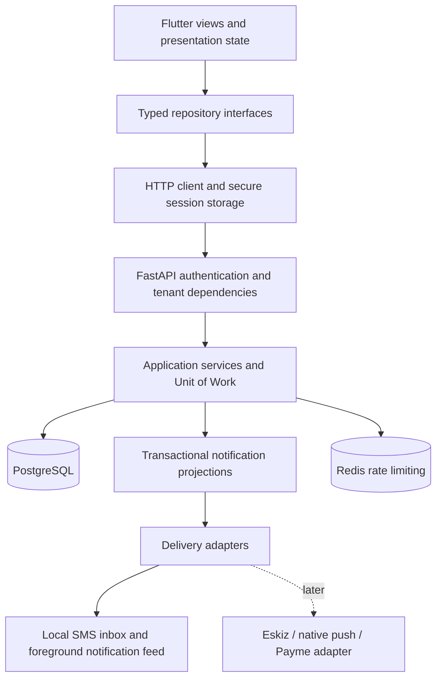

# GarageOS MVP architecture

Decision date: 2026-10-25. Implementation branch: `feat/android-mvp-live`.

## Product boundary

The 31-screen Flutter application serves customers, reception/owners and
assigned mechanics. The acceptance environment is Android Emulator with a real,
isolated local API and PostgreSQL database. SMS uses a local outbox and
notifications use the persisted in-app feed. Roadside is a request and status
workflow, not continuous vehicle tracking. Payme is a preparation contract only:
no live checkout, merchant credentials, settlement routing or money movement.

## System and dependencies

The backend remains a modular monolith. PostgreSQL is the source of truth.
Redis failure cannot silently disable deployed authentication/write limits.
Domain writes, notification projections and replay responses commit through the
same Unit of Work. External delivery happens after commit and is not proof of a
successful business operation. Reliable external delivery/retry must be verified
before a production SMS/push provider is enabled.

Flutter retains `ChangeNotifier`, `http`, the existing design system and typed
domain models. `AppState` owns identity/preferences; screen state owns rendering
and interactions; repositories own HTTP and DTO mapping. Views never fabricate
live results or compute authoritative financial/status transitions. Features
are auth, customers, vehicles, jobs, billing, messages, roadside and settings;
shared transport, media, localization and notification delivery are cross-cutting.

## Invariants

1. A verified principal and active garage determine tenant scope. User-supplied
   identifiers never select a tenant. Wrong-tenant/owner references return 404.
2. Customer access is limited to owned records. Mechanics operate only assigned
   work. Reception finance permissions and owner-only account administration
   are enforced on the server and reflected by explicit mobile capabilities.
3. Backend services own legal lifecycle transitions. A returned HTTP success is
   required before the UI shows a completed mutation.
4. Important retries retain one idempotency key, scoped on-device to API and
   identity. The same key with different content is rejected. An unknown reply
   is reconciled, never treated as a definite failure or retried with a new key.
5. Money uses backend Decimal and Flutter Money. UZS-to-Payme conversion uses
   exact integer tiyin; unsupported fractions/non-finite values are rejected.
6. Draft invoices do not create debt or accept payment. Sending a draft issues
   it once. Payments/refunds are records, not a mutable paid boolean.
7. Sessions use Android-protected storage. Refresh rotation is persisted;
   identity revisions prevent late login/refresh/logout responses from reviving
   a previous account. Photos and read caches are not shared across identities.
8. Demo repositories are explicit. Live API failures never fall back to demo
   data, fake coordinates, fake image captions or simulated payment success.
9. Screens cover loading, empty, success, failure, permission denial and retry.
   A failed background refresh preserves previously readable data.
10. UZ/RU/EN share one localization contract. Civil booking dates come from the
    service-center timezone; timestamps are stored with timezone information.
11. Files are verified server-side and downloaded through authenticated,
    tenant/owner-scoped routes. A URL or client file ID is not authorization.
12. Logs and evidence exclude credentials, OTP values, bearer tokens and private
    customer data. Synthetic local test material stays in ignored evidence.

## Compatibility and repository ownership

The primary repository is the canonical reviewed source. The mobile branch and
main have been combined in the integration branch. Standalone backend commit
`3ae7092` supplies phone/SMS authentication, file storage and customer lifecycle
APIs absent from the earlier monorepo snapshot. Preserve its migration chain and
security fixes when integrating additional changes.

The standalone Backend-repo is a deployment export, not an independently edited
second source. Export parity must resolve an explicit commit. Existing invoice
creation continues to issue by default; `draft=true` is additive. Existing
history APIs remain available while richer customer endpoints power the app.

`garageos/backend-export.json` pins the export commit and CI compares that exact
revision with the canonical backend tree. The current export uses the feature
branch `feat/android-mvp-local`; no Railway production branch is changed.

No production Railway operation is part of local acceptance. No owner/store
release is claimed from a debug-signed emulator APK. Actual verification status
is maintained in [mobile acceptance](../testing/mobile-acceptance.md).

## Payment integration boundary

Mobile timestamps use the garage's IANA zone from the authenticated staff/customer
profile, rather than the phone's zone. The timezone database applies the offset
at the event instant, including daylight saving. Calendar-only appointment dates
remain civil dates. The backend continues storing timezone-aware instants.

`PaymentGateway` and immutable `PaymentAttempt` model the check/create/perform/
cancel/get/statement contract. Replays preserve timestamps and results; cancelled
attempts cannot later complete. The current contract tests are local preparation,
not a Payme sandbox certification. A future adapter must persist provider IDs,
lock the invoice, verify provider authentication and amount, and post one payment
in the same transaction. A mobile redirect can never mark an invoice paid.

Merchant ownership and settlement destination remain an explicit unresolved
business decision. Production integration stays disabled until that decision,
merchant provisioning, authenticated callbacks and provider acceptance are done.
