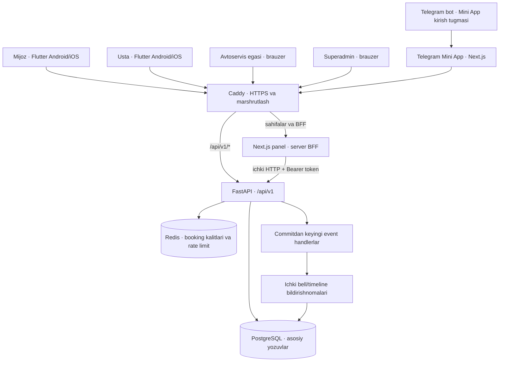
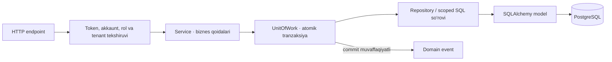
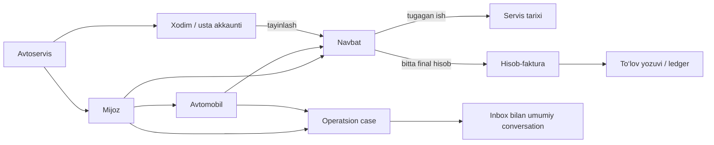
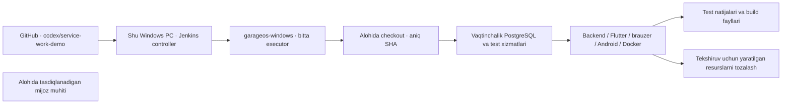

# GarageOS — loyiha arxitekturasi

Yangilangan: 2026-10-08. Ushbu hujjat repozitoriydagi amaldagi kodni tasvirlaydi.
Joriy tayyorlik va topshirish dalillari [delivery issue10](https://github.com/Shoamirg/garageos/issues/10)
da yuritiladi. Arxitektura hujjati mijozga topshirish tugaganini bildirmaydi.

GarageOS avtoservisdagi mijoz, avtomobil, navbat, usta, bajarilgan ish,
hisob-faktura va to‘lov tarixini boshqaradi. Biznes mantiqi bitta modullarga
ajratilgan FastAPI backendida; mobil ilova, brauzer paneli va Telegram Mini App
shu API bilan ishlaydi.

## 1. Umumiy tuzilma

Production Compose tashqariga faqat Caddy’ning80/443 portlarini chiqaradi.
PostgreSQL, Redis, API va panel konteynerlar orasidagi ichki tarmoqda ishlaydi.
Development Compose alohida konfiguratsiya bo‘lib, lokal portlarni ham ochadi.
Mijoz production serveri va domeni alohida sozlanadi.

## 2. Asosiy qismlar

| Qism | Texnologiya | Vazifasi | Kod manbasi |
| --- | --- | --- | --- |
| Mobil ilova | Flutter/Dart | Mijoz va usta oqimlari; mavjud staff oqimlari, UZ/EN/RU | [flutter_app](../../flutter_app/) |
| Brauzer paneli | Next.js15, React19, TypeScript | Avtoservis egasi va superadmin; Operations, Inbox, billing | [admin-dashboard](../../admin-dashboard/) |
| UI komponentlari | GarageOS design system, Tailwind | Bir xil ranglar, tugmalar, light/dark ko‘rinish | [packages](../../packages/) |
| API | Python3.12, FastAPI, Pydantic | Login, huquq tekshiruvi va biznes amallari | [app/main.py](../../backend/app/main.py) |
| Ma’lumot qatlami | SQLAlchemy2 async, asyncpg | Baza so‘rovlari va tranzaksiyalar | [repositories](../../backend/app/repositories/) |
| Asosiy baza | PostgreSQL16 production;18 lokal Windows QA | Doimiy biznes yozuvlari, cheklovlar, indekslar | [models](../../backend/app/models/) |
| Baza versiyalari | Alembic | Nazoratli schema migratsiyalari | [alembic](../../backend/alembic/) |
| Cache | Redis7 | Booking idempotency kalitlari va so‘rov tezligi cheklovi | [core](../../backend/app/core/) |
| Telegram bot | Python long polling | /start, /help va Mini App’ni ochish | [bot.py](../../telegram-bot/bot.py) |
| Production kirishi | Caddy2, Docker Compose | HTTPS, API/panel yo‘nalishlari | [production Compose](../../docker-compose.prod.yml) |
| CI | Lokal Windows Jenkins | Alohida checkout, test baza, build va natija fayllari | [Jenkinsfile](../../../Jenkinsfile) |

## 3. Backend ichidagi qatlamlar

Endpoint kiruvchi ma’lumotni tekshiradi. Dependency haqiqiy akkaunt va uning
huquqlarini aniqlaydi. Service biznes qoidalarini bajaradi; repository yoki
scoped SQL baza bilan ishlaydi. UnitOfWork tegishli yozuvlarni bir tranzaksiyada
saqlaydi yoki xatoda qaytaradi. Yozuvchi endpointlarda commit HTTP muvaffaqiyat
javobidan oldin bajariladi. Batafsil inventar: [API transactions](../api-transactions.md).

Domain eventlar muvaffaqiyatli commitdan keyin handlerlarga uzatiladi. Event
ro‘yxati jarayon xotirasida: hozir persistent outbox jadvali yoki Celery asosidagi
kafolatlangan navbat mavjud deb hisoblanmaydi. Jarayon uzilishi event yetkazishni
yo‘qotishi mumkin; handler bajarilishi tashqi xabar yetib kelganiga teng emas.
Amaldagi handlerlar eventni logga yozadi yoki ichki bildirishnomani bazada
saqlaydi. Eventdan tashqi Telegram/email/push yetkazish hali ulanmagan;
invoice’ni bevosita Telegram orqali yuborish alohida endpoint oqimidir.
[ADR0004](../ADRs/0004-event-driven-notifications.md) shu chegarani qayd etadi.

## 4. Akkaunt va ma’lumot chegaralari

| Rol | Asosiy sirt | Ma’lumot doirasi |
| --- | --- | --- |
| Mijoz | Flutter va customer API | O‘z mijoz akkaunti, avtomobillari va tegishli tarixi |
| Usta | Flutter va /mechanic/work | O‘z akkauntiga tayinlangan servis ishlari |
| Avtoservis egasi | Brauzer va tenant staff API | O‘z avtoservisi, xodimlari va biznes yozuvlari |
| Superadmin | Brauzer va /platform | Global GET-only platform ko‘rishi; akkaunt bog‘langan avtoservisda staff.read/staff.write |

Oddiy biznes yozuvlarining tenant kaliti `service_center_id`. Tenant ishonchli
autentifikatsiyalangan akkauntdan olinadi. So‘rovdagi boshqa servis ID’si bu
chegarani almashtirmaydi. Bog‘langan customer/vehicle/user yozuvlari ham zarur
joylarda alohida tekshiriladi; oddiy foreign key mavjudligi tenant xavfsizligini
o‘zi ta’minlamaydi.

Staff va password-customer login/token oqimlari ajratilgan. Superadmin platform
huquqi active super_admin roli va saqlangan platform flag’ini birga talab qiladi;
tenant API’da umumiy global bypass ochilmaydi. Global o‘chirish va impersonation
tasdiqlangan mavjud imkoniyat sifatida ko‘rsatilmaydi.
Superadmin rolining `staff.read` va `staff.write` huquqlari faqat akkaunt
bog‘langan avtoservis doirasida amal qiladi; global platform ko‘rish huquqi
boshqa servislarning tenant yozuvlarini o‘zgartirishga ruxsat bermaydi.

Brauzer staff loginida access token HttpOnly cookie’ga saqlanadi. Next.js BFF
uni ichki API so‘roviga Bearer header qilib qo‘shadi. Mobil ilova API bilan
to‘g‘ridan-to‘g‘ri ishlaydi. Huquqning yakuniy tekshiruvi backendda bajariladi.

Manbalar: [API dependencies](../../backend/app/api/deps.py),
[customer API](../../backend/app/api/v1/endpoints/customer/),
[ADR0005](../ADRs/0005-multi-tenancy-service-center-id.md),
[ADR0006](../ADRs/0006-explicit-platform-read-boundary.md).

## 5. Biznes modullari va bog‘lanishlar

| Modul | Vazifasi | API yo‘li |
| --- | --- | --- |
| Mijoz/avtomobil | Mijozlar, avtomobillar va tegishli tarix | /customers, /vehicles |
| Navbat/kalendar | Oldindan yaratilgan slotlar, booking, kalendar va usta tayinlash | /appointments, /slots, /calendar |
| Usta ishi | Tayinlangan ishni ko‘rish, boshlash va tugatish | /mechanic/work |
| Billing | Hisob-faktura, qo‘lda to‘lov qaydi va balans/ledger | /invoices, /reports |
| Operations | Case, status, usta va umumiy thread | /cases |
| Inbox | Conversation, participant, message va attachment metadata | /conversations |
| Customer portal | Mijozning home, avtomobil, tarix, billing va xabarlari | /customer/* |
| Platform | Servislar, akkauntlar va global read projection/statistika | /platform/* |

Slot-booking kaliti takroriy so‘rovda bitta navbatga olib boradi. Booking ID
cache’ga durable commitdan keyin qo‘yiladi; muvaffaqiyatsiz commit kalitni qayta
urinish uchun bo‘shatadi. To‘lov idempotency’si pulni takror yozishdan himoya qiladi.
Qo‘lda to‘lov qaydi bank kartasidan pul yechish emas. Valyutalar aralashtirilmaydi.

Operations va Inbox bir conversation modelidan foydalanadi. Case tenant/reference
tekshiruvi umumiy Inbox’ning barcha kirish yo‘llari sertifikatlanganini anglatmaydi.
[Case references](../case-reference-safety.md) va [case list API](../case-list-api.md)
shu doirani belgilaydi. API qidiruv/sahifalashi bilan panel integratsiyasi alohida
qatlamlardir; faqat API o‘zgarishi paneldagi eski yozuv qidiruvini yakunlamaydi.

## 6. Deploy va CI oqimi

Jenkins hozir foydalanuvchining kompyuterida ishlaydi; tekshiruv production deploy
emas. PC va foydalanuvchi sessiyasi faol bo‘lishi kerak. Natija o‘zgartirilayotgan
worktree uchun emas, aniq commit uchun baholanadi. Merge, release tag va mijozga
deploy alohida bosqichlar. Signed APK/iOS build, haqiqiy telefon va mijoz piloti
oddiy test muvaffaqiyatiga tenglashtirilmaydi.

Production stack: Caddy → Next.js yoki /api/v1 → FastAPI → PostgreSQL/Redis.
Telegram bot alohida jarayon. PostgreSQL va Redis named volume’larda saqlanadi;
bu o‘zi tashqi backup emas. Migratsiya Alembic tomonidan bajariladi, API startup
avtomatik yangi schema yaratmaydi.

Jenkins uchun sheriklarning akkaunt/huquqlari, HTTPS masofaviy ulanish va doimiy
manzil runtime sozlamalaridir. Ularning parollari, tokenlari va shaxsiy emaillari
Git’da yoki ushbu hujjatda saqlanmaydi.

## 7. Muhim hujjatlar

- [Domain atamalari](../../../CONTEXT.md)
- [Production deploy](../DEPLOYMENT.md)
- [Foydalanish yo‘riqnomasi](../USER-GUIDE.md)
- [Topshirish va operator ishlari](../HANDOFF.md)
- [Platform akkauntlarini sozlash](../PLATFORM-ACCOUNTS.md)
- [Navbat/kalendar](../calendar-workflow.md)
- [API tranzaksiyalari](../api-transactions.md)
- [Arxitektura qarorlari](../ADRs/)
- [Aktual yakunlash rejasi va qabul mezonlari](https://github.com/Shoamirg/garageos/issues/10)
